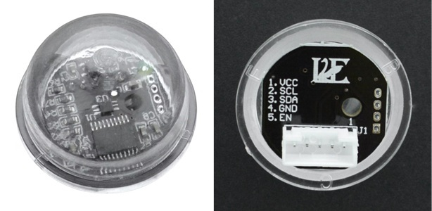

# Arduino Library for DFRobot B_LUX_V30B Ambient Light Sensor

**SKU: SEN0390**



This is a nice module with an automatically adjusted range of 0..200'000 LUX. This means you don't need to write fancy 'auto ranging' code because the module does it all for you.

It also automatically filters out infrared light, which often causes problems with LUX measurements because the human eye is not sensitive to infrared.

The sensor seems to be very accurate when compared to my LUX Meter. It measures very low LUX levels, down to 0.001 LUX, and has a response time of 5..10 seconds. The readings are very stable, with good smoothing.

The module has an HC32L110 microcontroller (a low power 32-bit 32MHz Cortex-M0+), which is designed for battery powered devices. 

The sensor is an LTR-303ALS-01 from Liteon, which rejects 50/60Hz flicker and has temperature, infrared and UV compensation.

## EN Pin

The 'Enable' pin (EN) is described in the data sheet as, "EN sensor chip select enable terminal, H high active, L close sensor".

The DFRobot library constructor requires the EN pin to be supplied, which is not so nice. In `begin()`, the DFRobot library toggles the EN pin low for 1 second, then sets it high. This looks like it's being used as a 'reset' pin.

In fact, it should be used as a _power on/power off_ pin, to save energy if the device is battery powered. 

The EN pin can also be used as a _chip select_ pin if you have multiple V30Bs connected to the same SDA/SCL pins. This is nice.

This _mumanchu_ library does not handle the EN pin itself. It can be connected to VCC so it's always enabled, or connected to a digital output so it can be powered off and on, or used as chip select.


## EEPROM, Electrically Erasable Programmable Read Only Memory

The module contains 112 bytes of nonvolatile EEPROM memory, which seems to be available to the user's application. The data sheet does not say much about this, only "EEPROM data storage".

This nonvolatile memory could be very useful for things like Serial Numbers and IP Addresses, etc.

The _mumanchu_ library contains `writeEEPROM()` and `readEEPROM()` methods.

> [!IMPORTANT]
> EEPROMs have a limited number of write cycles, typically 100'000 to 1'000'000, so don't write code that sits in a loop writing to EEPROM!


## I2C 

The DFRobot data sheet says the module runs on I2C at up to 400KHz. I was unable to make it work reliably using Hardware I2C `Wire`. At 100KHz it worked occasionally, but not well enough to be usable. The example sketch uses Software I2C, but can use `Wire` if you enable it, so you can try it yourself. Let me know if you get it working! Maybe I just have a bad module.

The official DFRobot library uses special Software I2C code, which works very well. This has the advantage that any GPIO pins can be used for SDA and SCL. I was also not able to make it work with other Software I2C libraries, so there is probably some kind of timing problem. 

You must either use the official DFRbot library, or use this _mumanchu_ library which has some improvements and additional features.

> [!IMPORTANT]
> When using software I2C, you _cannot_ use the standard SDA and SCL pins if you are also using `Wire` (hardware I2C) on those pins. Hardware I2C and Software I2C cannot share the same pins. 
> But that's not a big deal because you can use _any_ GPIO pins for Software I2C.


## Features of this _mumanchu_ Library

* Has additional EEPROM read/write methods for the 112 bytes of nonvolatile memory on the board.

* Uses `begin()` instead of a constructor for assigning the pins, so errors can be handled safely. 

* This library does not handle the `EN` pin, which can be tied to VCC. But you can handle the `EN` pin outside the library if you need to power down the module or use it for 'chip select'. See the 'EN Pin' section above.

* It has two `readLUX()` methods. One returns an `unsigned long` integer (0..200'000), which is fine for most purposes. The other method returns a `float` value, which is only needed if you want to measure very low light levels, below 1.0 LUX. At higher LUX levels, the minimum step will be several LUX, not fractions of a LUX, so you don't need a floating point value.

* All methods return `true` on success, `false` on failure (I2C communications or parameter error). 

* Tidied up DFRobot's Software I2C code.


## Class Reference

Refer to the comments in the source code [V30BAmbientLightSensor.h](src/V30BAmbientLightSensor.h) for full details of each method.

```cpp
class V30BAmbientLightSensor
{
public:
    bool begin(uint sdaPin, uint sclPin);
    bool setAutoMode();
    bool setManualMode(uint integrationTime, bool highBrightness);
    bool readLux(long* lux);
    bool readLux(float* lux);
    bool readEEPROM(uint adds, byte* data, uint length = 1);
    bool writeEEPROM(uint adds, const byte* data, uint length);
    bool writeEEPROM(uint adds, byte data) { return writeEEPROM(adds, &data, 1); }
};
```

## Example Sketch

The example sketch displays the LUX value in `ulong` and `float` units on the Serial Monitor.

To see the `float` value, you will need `sprintf()` to support floats, `"%f"`. You can sometimes select the "C Runtime Library" via the Arduino IDE "Tools" menu, e.g. "Newlib Nano + Float Printf". If not, you could use `floatToString()` which you can find here: \
https://github.com/mumanchu/mumanchu/blob/main/utils/Float.cpp

By default, the example sketch uses Software I2C. However, if you want to try using Hardware I2C, uncomment `#define V30B_USE_HARDWARE_I2C`. But I was unable to get this working - if you manage it, please let me know what you did.

It also contains code to test the 112 EEPROM registers, but this is patched out by default. To enable it, change `#if 0` to `#if 1`,

```cpp
// Set to 1 to enable the EEPROM tests
#if 0
...
#endif
```


## References

DFRobot Wiki Page \
https://wiki.dfrobot.com/sen0390/

SEN0390 V30B Data Sheet \
https://dfimg.dfrobot.com/wiki/18648/SEN0390_b-lux-v30b-ambient-light-sensor_datasheet_V1.0.pdf

Official DFRobot Library \
https://github.com/DFRobot/DFRobot_B_LUX_V30B

LTR-303ALS-01 Ambient Light Sensor \
https://optoelectronics.liteon.com/upload/download/DS86-2013-0004/LTR-303ALS-01_DS_V1.1.PDF


## Revision History

| Date       | Revision | Description |
|:---------- |:---------|:----------- |
| 2026.11.04 | 1.0.0    | Release v1.0.0 |


## Joke of the Week

What's the difference between an elk and a moose?

_You can't eat an elk with a spoon._


